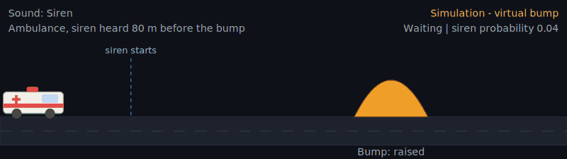
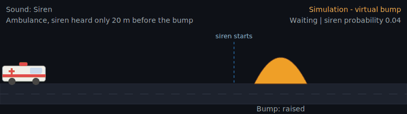
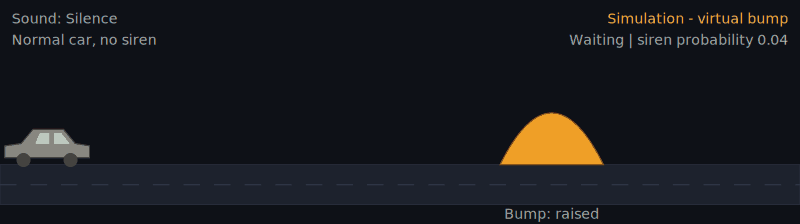
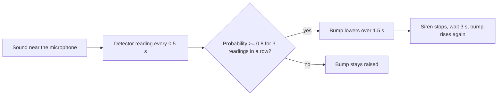

# ClearPath


**A Python simulation of a speed bump that flattens when it is confident it hears a siren, so an ambulance loses less time, and stays raised for everything else.**

> **Simulation only.** The sound options stand in for a siren detector. The app does not use a microphone, does not detect real sounds, and has not been tested on real roads. Every speed and timing value is an assumption, not a measurement.



*Animation rendered from the simulation's own drawing code.*

## The problem

Speed bumps slow ambulances down. A peer-reviewed measurement study of ambulance delay at speed humps ([PMC9922345](https://pmc.ncbi.nlm.nih.gov/articles/PMC9922345/)) reported roughly 8 to 10 seconds lost at a single hump (Turkish roads, so local results will differ). ClearPath asks a narrower question:

> If a bump could lower itself on a confirmed siren, how much warning does it need, and what happens when detection is late or wrong?

## What the simulation shows

| Scenario | What happens |
|---|---|
| Siren heard early | The siren is confirmed, the bump goes flat, and the ambulance loses much less time |
| Siren heard too late | The bump is still lowering when the ambulance arrives, so it slows anyway |
| Normal car, no siren | The bump stays raised, which is today's behaviour |
| Normal car while a siren plays elsewhere | **False alarm**: the bump lowers when it should not |





## How it works

All logic is plain Python in `app.py`. Streamlit only displays what Python computes.



| Function | Job |
|---|---|
| `simulate()` | Steps the trip forward in 0.05 s: detector readings, bump height and vehicle speed |
| `evaluate()` | Decides the outcome at the bump (correct, late, missed or false alarm) and the time saved against a run where the bump never lowers |
| `scene_svg()` | Draws the road, bump and vehicle from the numbers |
| `main()` | Lays out the page |

**Fail-safe rule:** the bump starts raised and only lowers after a confirmed siren. When unsure, nothing changes.

### Example results (default settings)

These are outputs of the simulation under the assumptions below, not real-world measurements.

| Siren first heard | Outcome | Time saved vs a raised bump |
|---|---|---|
| 100 m before the bump | Correct | 5.8 s |
| 80 m | Correct | 5.1 s |
| 60 m | Correct | 4.1 s |
| 40 m | Correct | 1.9 s |
| 20 m | Late | 0.4 s |

With the default assumptions, a raised bump costs the ambulance about 6 seconds.

## Assumptions (all of these are editable in `Params`)

| Parameter | Default | Meaning |
|---|---|---|
| `cruise_mps` | 16.7 | Ambulance speed, about 60 km/h |
| `cross_mps` | 4.0 | Speed over a raised bump |
| `decel_mps2` / `accel_mps2` | 2.5 / 1.5 | Braking and speeding up |
| `threshold` | 0.8 | Probability needed to count a reading as "siren" |
| `confirm_readings` | 3 | Readings in a row needed to confirm |
| `retract_time_s` | 1.5 | Time for the bump to go flat |
| `hold_time_s` | 3.0 | Bump rises this long after the siren stops |

The detector's probability comes from a simple formula (siren 0.93, car horn 0.22, silence 0.03, smoothed with a little noise). It is **not a trained model**.

## Run it

```bash
python3 -m venv .venv
source .venv/bin/activate
pip install -r requirements.txt
python3 -m streamlit run app.py
```

Then open http://localhost:8501, choose a sound and a vehicle, and click **Run simulation**.

## Limitations

- It is a simulation. Nothing here was tested on a real road or with real ambulances.
- No microphone input and no trained detector. The probability is generated by a formula.
- The assumed speeds and timings are placeholders until replaced with measured data.
- Pedestrians crossing at the bump, traffic queues ahead, multiple vehicles and spoofed sirens are not modelled.
- Session counters in the app are not a measured accuracy.
- Any real installation would need safety testing and certification.

## Related work

The idea of a retractable or siren-triggered speed bump is not new. Examples include a [patent for a retractable speed bump controlled from emergency vehicles](https://patents.google.com/patent/US5509753), a [patent describing audio siren detection that lowers the bump](https://image-ppubs.uspto.gov/dirsearch-public/print/downloadPdf/9951487), and a [research paper on smart speed bumps with LoRa](https://arxiv.org/pdf/2307.00433). ClearPath does not claim to invent the concept. It is a small, transparent model for exploring timing and failure cases.

## Next steps

- Record real siren, horn and traffic sounds and train a detector with a leak-free evaluation
- Replace the assumed values with a measured speed trace over a real bump
- Add a traffic-queue scenario and a pedestrian-hold rule

## Project files

```
app.py            the whole simulation and page
requirements.txt  Python dependencies
docs/             animated previews used in this README
```
